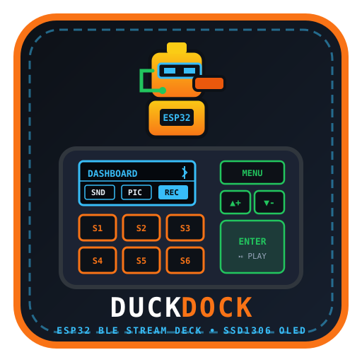
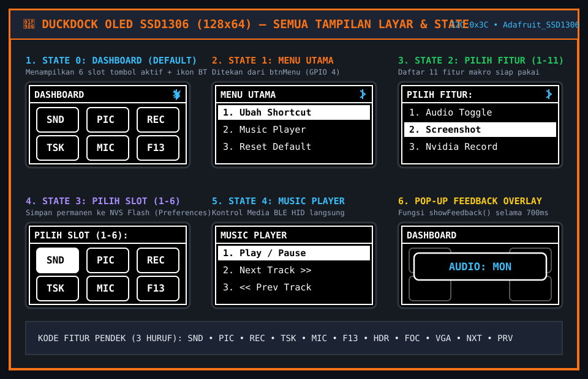
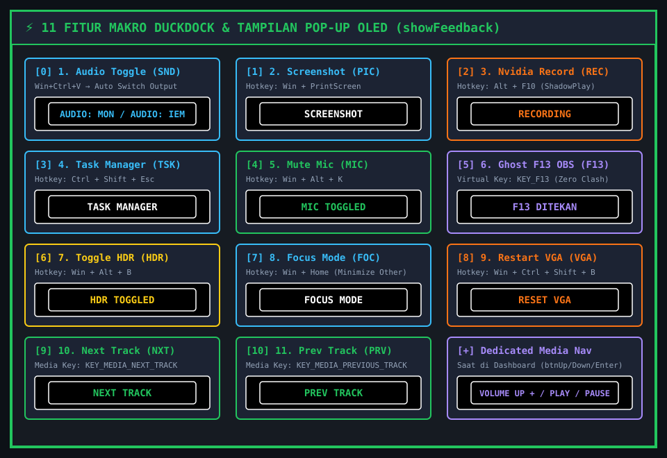
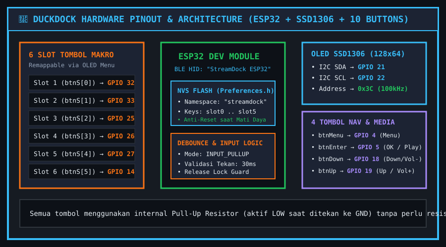

  

  <h1>🦆 DuckDock — ESP32 BLE Stream Deck & Dynamic Macro Pad</h1>
  

    <strong>Wireless Bluetooth Low Energy (BLE) Macro Controller berbasis ESP32 dengan Layar OLED SSD1306 (128×64), 10 Tombol Fisik, On-Device Key Remapping, dan Penyimpanan Permanen NVS Flash.</strong>
  

  

    
    
    
    
  

---

## 📖 Deskripsi Proyek

**DuckDock** adalah perangkat keras *Stream Deck* / *Macro Pad* nirkabel yang dirancang menggunakan mikrokontroler **ESP32**, layar **OLED SSD1306 128×64 (I2C)**, dan **10 tombol taktil**.

Berbeda dengan macro pad DIY biasa yang mengharuskan pengguna mengubah kode program dan melakukan *upload* ulang setiap kali ingin mengganti fungsi tombol, **DuckDock memiliki sistem menu interaktif langsung di layar OLED (`On-Device Remapping`)**. Pengguna dapat memilih dari **11 database fitur makro** dan menaruhnya ke slot tombol mana pun secara langsung, serta menyimpannya ke dalam memori **NVS Flash (`Preferences.h`)** sehingga konfigurasi tetap tersimpan meskipun perangkat dimatikan.

---

## ✨ Fitur Unggulan

1. **🔄 On-Device Dynamic Button Remapping (Tanpa Coding Ulang)**
   Ubah fungsi ke-6 slot tombol shortcut kapan saja langsung melalui menu layar OLED dan simpan secara permanen ke memori internal ESP32 (`Preferences`).
2. **📡 Wireless Bluetooth Low Energy (BLE HID)**
   Terdeteksi langsung sebagai keyboard/media controller Bluetooth bernama **`StreamDock ESP32`** di Windows/macOS/Linux dengan indikator ikon Bluetooth *real-time* di pojok kanan atas layar OLED.
3. **🖥️ 5 State Antarmuka Layar OLED + Pop-up Feedback**
   Dilengkapi antarmuka grafis berbasis `Adafruit_SSD1306` yang menampilkan *Dashboard Grid 3×2*, *Menu Utama*, *Pemilihan 11 Fitur*, *Pemilihan Target Slot*, *Music Player*, serta *Pop-up Overlay Feedback* selama `700 ms` setiap kali aksi dieksekusi.
4. **🎵 Dual-Role Navigation & Direct Media Controls**
   Keempat tombol kontrol (`Menu`, `Up`, `Down`, `Enter`) otomatis berfungsi sebagai pengatur **Volume Up (+)**, **Volume Down (-)**, dan **Play/Pause** saat berada di layar utama (*Dashboard*).
5. **🛡️ Software Debouncing & Release Guard**
   Menggunakan fungsi `tekanValid()` (validasi 30 ms) dan `tungguTombolDilepas()` dengan `INPUT_PULLUP` internal untuk mencegah *double-click* atau *ghost press*.

---

## 🖥️ Tampilan Layar OLED SSD1306 (Semua State)

Berikut adalah visualisasi presisi dari 6 tampilan layar OLED (128×64 piksel) yang dirender oleh `updateOLED()` dan `showFeedback()`:

  

| State (`appState`) | Nama Layar | Fungsi & Navigasi |
| :---: | :--- | :--- |
| **Boot** | `SYSTEM BOOTING` | Layar inisialisasi awal selama `800 ms` saat ESP32 menyala. |
| **`0`** | `DASHBOARD` | Menampilkan grid 3×2 berisi kode 3 huruf (`SND`, `PIC`, `REC`, `TSK`, `MIC`, `F13`) + indikator koneksi Bluetooth di kanan atas. |
| **`1`** | `MENU UTAMA` | Dibuka dengan menekan `btnMenu`. Berisi 4 opsi: `1. Ubah Shortcut`, `2. Music Player`, `3. Reset Default`, dan `4. Kembali`. |
| **`2`** | `PILIH FITUR:` | Daftar *scrollable* 11 fitur makro yang tersedia untuk dipilih. |
| **`3`** | `PILIH SLOT (1-6):` | Memilih slot tombol target (bisa dipilih menggunakan tombol `Up/Down + Enter` atau **menekan langsung tombol fisik slot 1–5**). |
| **`4`** | `MUSIC PLAYER` | Menu pemutar media khusus: `Play / Pause`, `Next Track >>`, `<< Prev Track`, dan `Mute Audio`. |

---

## ⚡ Database 11 Fitur Makro & Pop-up Feedback OLED

Setiap fitur yang dieksekusi akan mengirimkan kombinasi perintah **BLE HID Keyboard / Media Key** ke komputer dan menampilkan pop-up konfirmasi di tengah layar OLED:

  

| ID | Kode OLED | Nama Fitur di Menu | Kombinasi Keystroke / Makro BLE HID | Teks Pop-up OLED (`showFeedback`) | Kegunaan Utama |
| :-: | :-: | :--- | :--- | :---: | :--- |
| `0` | **`SND`** | `1. Audio Toggle` | `Win + Ctrl + V` → `4× Up` → `1×/2× Down` → `Enter` → `Esc` | `AUDIO: MON` / `AUDIO: IEM` | Berpindah output suara Windows otomatis antara Speaker Monitor dan IEM/Headset. |
| `1` | **`PIC`** | `2. Screenshot` | `Win + PrintScreen` | `SCREENSHOT` | Mengambil tangkapan layar penuh dan menyimpannya otomatis ke folder Pictures. |
| `2` | **`REC`** | `3. Nvidia Record` | `Alt + F10` | `RECORDING` | Menyimpan rekaman *Instant Replay* / memulai rekaman di Nvidia ShadowPlay. |
| `3` | **`TSK`** | `4. Task Manager` | `Ctrl + Shift + Esc` | `TASK MANAGER` | Membuka Windows Task Manager secara instan. |
| `4` | **`MIC`** | `5. Mute Mic` | `Win + Alt + K` | `MIC TOGGLED` | Menyenyapkan / mengaktifkan mikrofon global di Windows 11. |
| `5` | **`F13`** | `6. Ghost F13 (OBS)` | `KEY_F13` | `F13 DITEKAN` | Tombol virtual F13 untuk *hotkey* scene/recording di **OBS Studio** tanpa bentrok dengan tombol keyboard biasa. |
| `6` | **`HDR`** | `7. Toggle HDR` | `Win + Alt + B` | `HDR TOGGLED` | Menyalakan atau mematikan mode layar HDR di Windows. |
| `7` | **`FOC`** | `8. Focus Mode` | `Win + Home` | `FOCUS MODE` | Meminimalkan seluruh jendela aplikasi lain kecuali jendela yang sedang aktif. |
| `8` | **`VGA`** | `9. Restart VGA` | `Win + Ctrl + Shift + B` | `RESET VGA` | Me-restart driver GPU (kartu grafis) secara instan saat layar mengalami *freeze* atau glitch. |
| `9` | **`NXT`** | `10. Next Track` | `KEY_MEDIA_NEXT_TRACK` | `NEXT TRACK` | Melompat ke lagu/video berikutnya di Spotify/YouTube/Media Player. |
| `10` | **`PRV`** | `11. Prev Track` | `KEY_MEDIA_PREVIOUS_TRACK` | `PREV TRACK` | Kembali ke lagu/video sebelumnya. |

---

## 🔌 Konfigurasi Pinout Perangkat Keras (ESP32 & SSD1306)

  

### 1. Layar OLED SSD1306 128×64 (I2C)
| Pin OLED | Pin ESP32 | Keterangan |
| :--- | :--- | :--- |
| `VCC` | `3.3V` | Tegangan suplai layar OLED |
| `GND` | `GND` | Ground |
| `SDA` | **`GPIO 21`** | Jalur data I2C (`Wire.begin(21, 22)`) |
| `SCL` | **`GPIO 22`** | Jalur clock I2C (`100 kHz`, Alamat `0x3C`) |

### 2. Tombol Navigasi & Media Dedicated (4 Tombol)
| Variabel | Pin ESP32 | Fungsi saat di Dashboard (`State 0`) | Fungsi saat di dalam Menu (`State 1–4`) |
| :--- | :---: | :--- | :--- |
| `btnMenu` | **`GPIO 4`** | Membuka `MENU UTAMA` | Kembali ke layar sebelumnya / Dashboard |
| `btnUp` | **`GPIO 19`** | `VOLUME UP +` (`KEY_MEDIA_VOLUME_UP`) | Geser kursor pilihan ke atas |
| `btnDown` | **`GPIO 18`** | `VOLUME DOWN -` (`KEY_MEDIA_VOLUME_DOWN`) | Geser kursor pilihan ke bawah |
| `btnEnter` | **`GPIO 5`** | `PLAY / PAUSE` (`KEY_MEDIA_PLAY_PAUSE`) | Konfirmasi / Pilih menu (`OK`) |

### 3. Slot Tombol Shortcut Kustom (6 Slot)
| Slot | Variabel Array | Pin ESP32 | Default Awal (`Reset Default`) |
| :---: | :--- | :---: | :--- |
| **Slot 1** | `btnS[0]` | **`GPIO 32`** | `SND` (`1. Audio Toggle`) |
| **Slot 2** | `btnS[1]` | **`GPIO 33`** | `PIC` (`2. Screenshot`) |
| **Slot 3** | `btnS[2]` | **`GPIO 25`** | `REC` (`3. Nvidia Record`) |
| **Slot 4** | `btnS[3]` | **`GPIO 26`** | `TSK` (`4. Task Manager`) |
| **Slot 5** | `btnS[4]` | **`GPIO 27`** | `MIC` (`5. Mute Mic`) |
| **Slot 6** | `btnS[5]` | **`GPIO 14`** | `F13` (`6. Ghost F13 OBS`) |

> **Catatan Rangkaian:** Seluruh tombol dikonfigurasi menggunakan `INPUT_PULLUP` internal ESP32. Satu kaki tombol dihubungkan ke pin GPIO terkait dan kaki lainnya langsung dihubungkan ke `GND` (tanpa memerlukan resistor eksternal).

---

## 🛠️ Kebutuhan Library & Instalasi (Arduino IDE)

1. **Board Manager:**
   - `esp32` by Espressif Systems (Pilih board: **ESP32 Dev Module**).
2. **Libraries:**
   - `Adafruit GFX Library` (via Library Manager)
   - `Adafruit SSD1306` (via Library Manager)
   - `ESP32-BLE-Keyboard` by T-vK ([Unduh ZIP dari GitHub](https://github.com/T-vK/ESP32-BLE-Keyboard))
   - `Wire.h` & `Preferences.h` (Bawaan core ESP32)

---

## 👨‍💻 Author

**Maulana Agus Setiawan**  
- 🌐 Portfolio: [maulanaasetiawan.vercel.app](https://maulanaasetiawan.vercel.app)  
- 🐙 GitHub: [@MaulanaASetiawan](https://github.com/MaulanaASetiawan)
